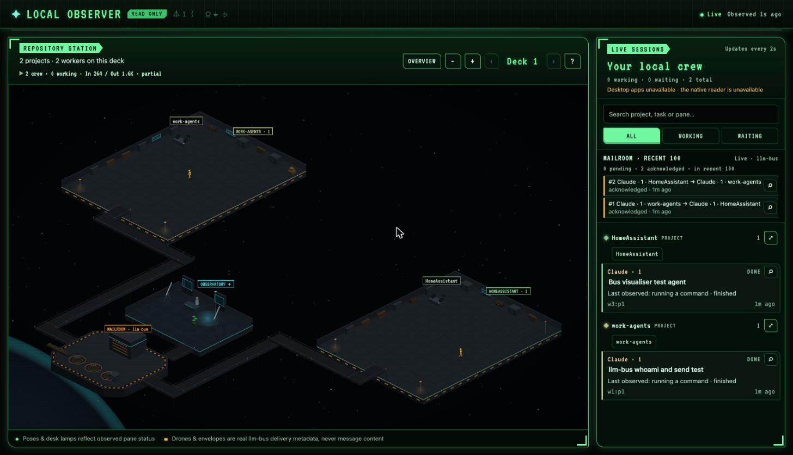

# Local Observer

A standalone, read-only browser view of local Codex and Claude Code sessions, drawn as an isometric pixel-art station. Start it from your terminal, then keep working in your normal agent terminals. It shows project/repository groups, session status, available token usage, transcript inspectors, and animated llm-bus message couriers.



You do **not** need to install or run StarNet. The necessary observer code, shared helpers, and three crew sprite sets are included here. This is a local companion app, not a Herdr plugin installed with `herdr plugin install`.

## Dependencies

| Dependency | Purpose |
| --- | --- |
| macOS | Supported and tested platform for this initial release. |
| [Node.js](https://nodejs.org/en/download) 22.13 or newer | Runs the local server; built-in SQLite reads bus and helper-session snapshots. |
| Git | Cloning, updates, and read-only repository/worktree detection. |
| [Herdr](https://herdr.dev/docs/install/) | Discovers Codex and Claude Code agents running in Herdr panes. Start your terminal agents inside Herdr. |
| Codex CLI and/or Claude Code | Supply the sessions and their locally stored transcripts. Authenticate them normally; this observer needs no provider API keys. |
| [Python](https://www.python.org/downloads/macos/) 3.11 or newer | Reads Codex TOML configuration and verifies process identity on macOS. |
| [llm-bus](https://github.com/wnz99/llm-bus) (optional) | Supplies local agent registrations, message couriers, and message inspectors. Without it, terminal observation still works, but mail is unavailable. |
| Xcode Command Line Tools (optional) | Supplies `swiftc` for observing the Codex desktop app. Not needed for terminal-only use. |

There are no npm package dependencies. Use Node to launch it even if you normally use Bun; the readers use `node:sqlite`.

## Install the observer

After installing Node, Git, Herdr, and Python:

```sh
git clone https://github.com/wnz99/starnet-observer.git
cd starnet-observer
npm ci
npm start
```

Open **http://127.0.0.1:4319** in your browser. Keep the server terminal open. Stop with **Ctrl+C**.

You can also run `node server.js` directly. Start it from any directory with `node /path/to/starnet-observer/server.js`. If port 4319 is occupied:

```sh
PORT=4320 npm start
```

The server prints the address to open. It listens only on your own computer's loopback address.

## Start terminal agents with Herdr

Install Herdr using its [official installation guide](https://herdr.dev/docs/install/). On macOS with Homebrew:

```sh
brew install herdr
```

In a separate terminal, start Herdr in the project you want to observe:

```sh
cd /path/to/your/project
herdr
```

Launch `codex` or `claude` inside a Herdr pane. Check discovery from another terminal:

```sh
herdr agent list
```

Keep using those terminals normally. The browser observer refreshes about every two seconds. It reads sessions across the active Herdr inventory, not just the folder where you launched the observer.

For a named/non-default Herdr server, launch the observer with `HERDR_SOCKET_PATH` set to that server's Unix socket. The default is `~/.config/herdr/herdr.sock`.

### Codex session identity

The observer requires a proven session identity before showing a transcript. It uses Herdr's published identity when available. A fallback reads the Codex terminal footer through the local Herdr socket only when Codex explicitly configures `thread-id` as the **first** status-line field.

If Codex panes appear but their transcript inspector is unavailable, check your Codex configuration (`~/.codex/config.toml`, or `$CODEX_HOME/config.toml`). Merge this field into your existing `[tui]` table; do not duplicate the table or overwrite other settings:

```toml
[tui]
status_line = ["thread-id"]
```

Keep any other status-line fields after `thread-id`, then restart the affected Codex pane. Python 3.11+ and an accessible local Herdr socket are needed for this fallback. An unresolved identity stays unavailable rather than opening a guessed session.

## Enable llm-bus mail and couriers

[llm-bus](https://github.com/wnz99/llm-bus) is a separate local mailbox for Claude Code and Codex. Install [uv](https://docs.astral.sh/uv/getting-started/installation/) first. Close your Codex and Claude Code sessions before installing its hooks:

```sh
git clone https://github.com/wnz99/llm-bus.git
cd llm-bus
uv tool install --from . llm-bus
llm-bus install
```

Restart your agents. In Codex, review and trust the bus hooks in `/hooks`, as described in the [bus README](https://github.com/wnz99/llm-bus#install-and-verify). If the command is missing, run `uv tool update-shell` and open a new terminal.

Run `llm-bus whoami` through each agent's shell tool to confirm registration. Agents use `llm-bus send` to exchange messages; the observer visualizes that traffic. It never sends, acknowledges, or wakes agents itself.

The observer reads the default macOS mailbox at `~/.local/share/llm-bus/bus.sqlite3`. If you use a custom bus database, set `LLM_BUS_DB` to the same database file when launching it. The bus must have actual messages for couriers to appear.

## Optional Codex desktop observation

Terminal users can skip this. For Codex desktop windows, install Apple's command-line tools if `swiftc` is missing:

```sh
xcode-select --install
```

The observer compiles its bundled Swift reader lazily. Grant Accessibility access to the terminal app running the server under **System Settings → Privacy & Security → Accessibility**, then restart the observer if needed. The desktop reader covers the Codex app; it does not monitor ordinary ChatGPT or Claude Desktop windows.

## Privacy and limits

- Observation is read-only: no agent launching, provider setup, message sending, acknowledgments, or session edits.
- Session and message text is read on demand when you open its inspector. Recognized credential patterns are redacted; private prose and file paths may still be visible. Share the code, not your session data.
- The local API requires a per-launch token delivered to the local page. Foreign origins and hostnames are rejected. Do not expose the server through a public proxy.
- Missing sources appear unavailable. Old data is marked stale; absence of a source is not treated as a fresh empty roster.
- macOS terminal use is the supported initial target. Other platforms are not validated; native Codex desktop observation is macOS-only.
- No cloud service, model calls, database server, or StarNet account is required.

## Update and test

Stop the observer before updating:

```sh
git pull --ff-only
npm ci
npm start
```

For the regression suite:

```sh
npm test
```

## Credits

The observer and selected sprite/runtime helpers were extracted from [StarNet](https://github.com/androoAGI/starnet), with its MIT license retained. [Herdr](https://herdr.dev/) and [llm-bus](https://github.com/wnz99/llm-bus) remain separate projects. VT323 is bundled under the SIL Open Font License; see [NOTICE.md](NOTICE.md).
